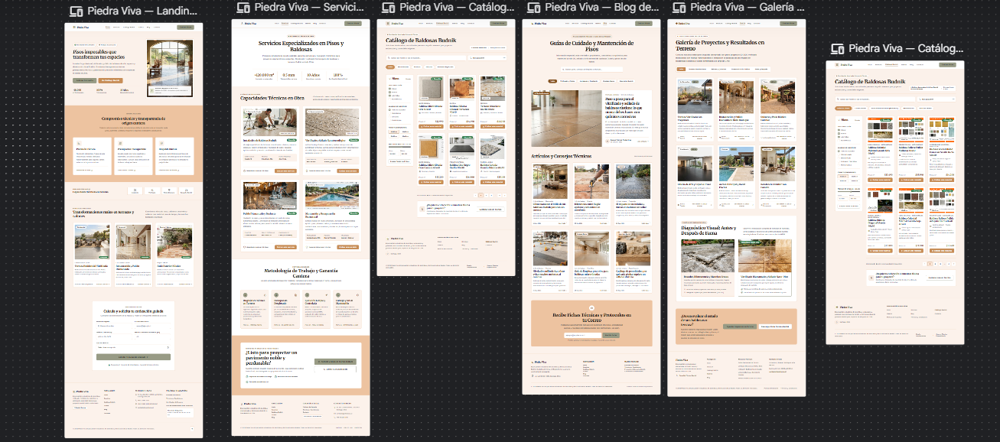
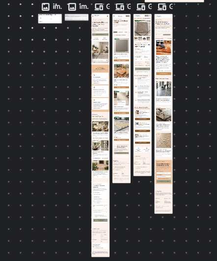

# QA — Piedra Viva — Sitio web

> Guía: [QA y coherencia](../evaluacion/guias/fase-3-prototipo/02-qa-y-coherencia.md)

## Prototipo en Stitch

> Guía: [Prototipo en Stitch](../evaluacion/guias/fase-3-prototipo/01-prototipo-en-stitch.md)

**Proyecto:** [Prototipo Piedra Viva en Google Stitch](https://stitch.withgoogle.com/projects/9760726042297367018?pli=1)

<!-- Capturas en docs/img/ de las 6 pantallas en desktop y mobile -->

| Pantalla | Desktop | Mobile |
|---|---|---|
| Landing |  |  |
| Tienda | *(captura pendiente)* | *(captura pendiente)* |
| Ficha de producto | *(captura pendiente)* | *(captura pendiente)* |
| Carrito | *(captura pendiente)* | *(captura pendiente)* |
| Blog | *(captura pendiente)* | *(captura pendiente)* |
| Artículo | *(captura pendiente)* | *(captura pendiente)* |

## Revisión: spec vs. prototipo

<!-- Una fila por diferencia. Resultado: ✅ / ❌ → ✅ / ❌ -->

| Pantalla | Qué dice la spec | Qué generó Stitch | Resultado | Corrección |
|---|---|---|---|---|
| Landing | Hero con botón principal `button-primary` con fondo `#989B85` y texto carbón `#2B2B28` (WCAG AA). | Generó botón verde oliva pero con texto blanco `#FFFFFF`, con contraste insuficiente. | ❌ → ✅ | Se ajustó el prompt indicando explícitamente `textColor: #2B2B28` según tokens de `DESIGN.md`. |
| Landing | Formulario de cotización guiada con campos: Nombre, Correo, Teléfono, Metros cuadrados (m²) y selector de servicio. | Generó un formulario de contacto estándar sin campo de m² ni selector de tipo de trabajo. | ❌ → ✅ | Se reescribió el ítem del formulario en el prompt especificando los inputs requeridos y se regeneró. |
| Tienda | Barra lateral izquierda con filtros de Uso (Interior, Exterior, Alto Tráfico) y 6 `card-product` a la derecha. | Mostró la grilla de productos pero omitió la columna lateral de filtros. | ❌ → ✅ | Se reforzó en el prompt: "Layout de 2 columnas: barra lateral izquierda fija de filtros + grilla de 3 columnas". |
| Tienda | Cada tarjeta de producto muestra foto cuadrada, precio por m² "$12.990", tag de disponibilidad y botón secundario. | Tarjetas con foto, precio y botón `button-secondary` en Dorado Cantera `#C48A54`. | ✅ | — |
| Ficha de producto | Selector de cantidad enfocado en superficie (m²) y cálculo de cajas necesarias. | Generó un selector genérico de "unidades" tipo e-commerce estándar. | ❌ → ✅ | Se modificó la spec y el prompt para exigir selector de m² compatible con proyectos de baldosas. |
| Ficha de producto | Fila inferior con 3 productos recomendados y fragües compatibles. | Generó correctamente las 3 tarjetas de materiales compatibles bajo la ficha técnica. | ✅ | — |
| Carrito (mobile) | Calculadora de despacho por comuna y resumen de cotización ubicados debajo de la lista en columna única. | Intentó mantener 2 columnas estrechas en mobile, cortando los totales de la cotización. | ❌ → ✅ | Se aplicó la instrucción responsive mobile: apilar la calculadora bajo los ítems con ancho 100%. |
| Carrito | Botón de acción principal "Enviar Cotización por WhatsApp" (`button-secondary`). | Mostró botón de pago bancario convencional "Proceder al pago". | ❌ → ✅ | Se corrigió el CTA en el prompt para adaptarlo al modelo de cotización asistida de Piedra Viva. |
| Blog | Grilla de 3 columnas con tarjetas de artículo, tag de categoría ("Pulido", "Instalación", "Cuidado") y tiempo de lectura. | Grilla ordenada con tipografía Merriweather en títulos y etiquetas de categoría visibles. | ✅ | — |
| Artículo | Contenedor de lectura centrado (máx. 800px) y caja CTA final con fondo `#EDC3A0` para cotizar pulido. | El texto abarcaba todo el ancho de la pantalla sin bloque destacado de cotización final. | ❌ → ✅ | Se añadió al prompt el contenedor centrado de lectura y la caja de llamada a la acción con fondo `#EDC3A0`. |
| Navbar (mobile) | Menú colapsable en icono hamburguesa con botón "Cotizar Ahora" integrado al desplegable. | Stitch intentó mostrar todos los enlaces horizontales apretados en la cabecera móvil. | ❌ → ✅ | Se agregó al prompt mobile la instrucción estricta de colapsar la navegación en menú hamburguesa. |

## Mejoras a mis specs

<!-- Qué cambiaste en DESIGN.md o en tus prompts después de ver el resultado. -->

- **En `09-spec-diseno.md` (Carrito):** Se definió explícitamente la adaptación responsive para que la calculadora de flete y el botón de WhatsApp ocupen el 100% del ancho bajo el listado en pantallas móviles (< 768px).
- **En `09-spec-diseno.md` (Ficha de producto):** Se cambió la especificación de cantidad de "unidades" a "metros cuadrados (m²)", permitiendo a los clientes cotizar el metraje exacto de su proyecto.
- **En `DESIGN.md` (Do's and Don'ts):** Se reforzó la regla de accesibilidad: no usar texto blanco sobre el botón primario `#989B85`, manteniendo siempre `#2B2B28` para cumplir el ratio 7.2:1 (WCAG AA).

## User flows

| Flujo | Recorrido en el prototipo | ¿Se completa? |
|---|---|---|
| Compra / Cotización | Landing → Clic en "Catálogo Budnik" → Tienda (filtra por Uso: Interior y Alto Tráfico) → Clic en "Baldosa Microvibrada Gris" → Ficha de producto (ingresa m² y selecciona Instalación + Pulido) → Clic en "Añadir a Cotización" → Carrito (ingresa comuna para cálculo de despacho) → Clic en "Enviar Cotización por WhatsApp". | ✅ |
| Contenido educativo | Blog → Clic en artículo "Paso a paso para el vitrificado y pulido de baldosas rústicas" → Lectura de recomendaciones técnicas → Clic en caja CTA final "Cotizar servicio profesional de pulido" → Formulario de Cotización de Landing / Ficha de Producto → Carrito / WhatsApp. | ✅ |

## Coherencia

El prototipo de Piedra Viva responde directamente al objetivo del brief: captar cotizaciones 100% online y generar confianza inmediata en el estándar de instalación, pulido y distribución oficial de baldosas Budnik. Resuelve la principal frustración de Renata (arquitecta de 40 años), quien necesita un proveedor "llave en mano" para no perder tiempo coordinando albañiles y tiendas por separado: la ficha técnica le permite presupuestar material y mano de obra juntos por metro cuadrado, y el carrito calcula el despacho por comuna antes de transferir la cotización desglosada a WhatsApp. Asimismo, la galería de acabados vitrificados y los artículos técnicos del blog mitigan su temor a malas terminaciones o problemas de nivelación en obra. Respecto a la Fase 1, se simplificó el checkout eliminando la pasarela de pago bancario rígida, reemplazándola por el envío directo de la cotización calculada hacia WhatsApp, lo que se adapta mucho mejor a la compra técnica de baldosas y a los hábitos de comunicación ágil de Renata.
